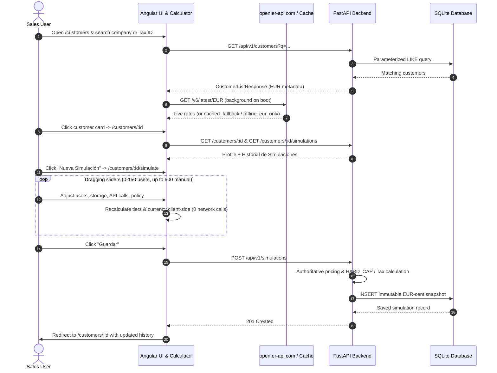
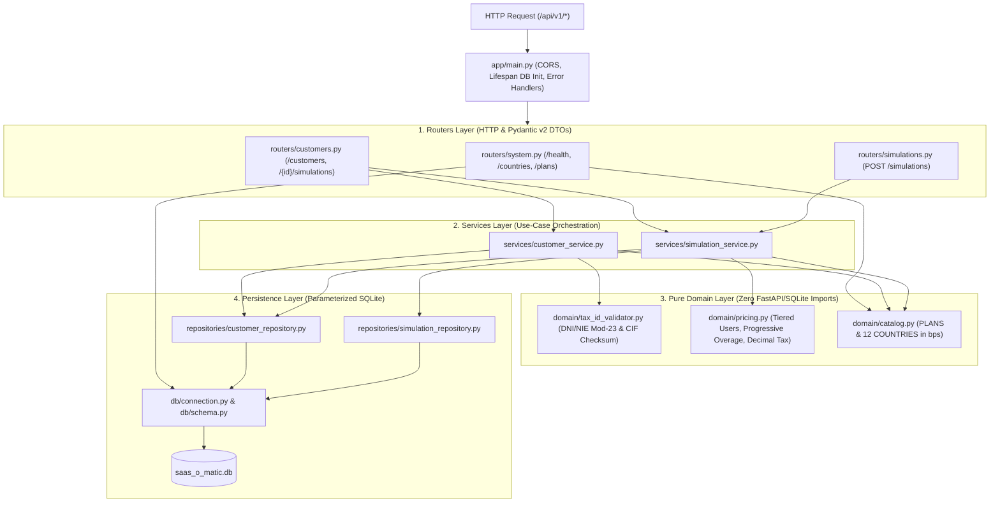
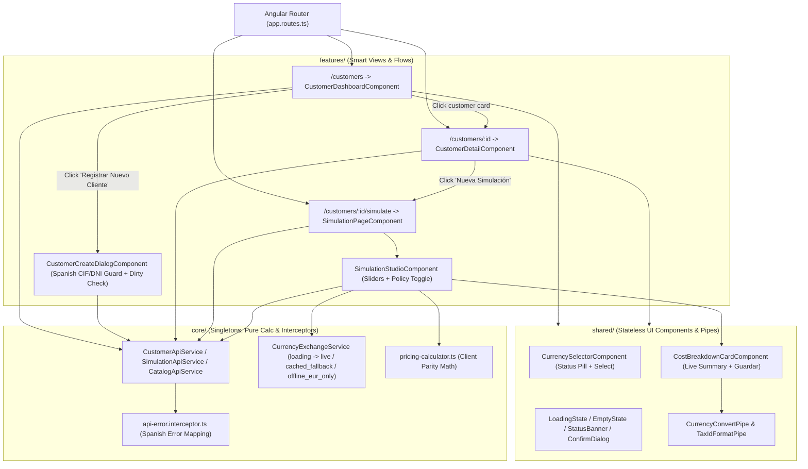

# SaaS-O-Matic

Dynamic multi-currency SaaS billing & subscription optimizer for corporate sales teams, built with **FastAPI + SQLite** and **Angular 19 + Angular Material**.

> **Live Demo (GitHub Pages):** **[https://elegarc.github.io/saas_o_matic/](https://elegarc.github.io/saas_o_matic/)**
> Deployed automatically as an interactive static demo (`--configuration=github-pages`). All `/api/v1/*` calls run against an in-browser mock API backed by `localStorage` with pre-seeded B2B clients, real DNI/NIE/CIF validation, real tiered/overage pricing calculations, and live EUR exchange rates from `open.er-api.com`. Use the **"Restablecer datos demo"** banner action at any time to restore the initial seed data.

---

## Table of Contents

1. [Overview and Key Capabilities](#1-overview-and-key-capabilities)
2. [Prerequisites and Quick Start](#2-prerequisites-and-quick-start)
3. [Repository Structure and AI Workspace](#3-repository-structure-and-ai-workspace)
4. [System Architecture and Diagrams](#4-system-architecture-and-diagrams)
   * [How Everything Works Together](#how-everything-works-together)
   * [End-to-End Request and Simulation Flow](#end-to-end-request-and-simulation-flow)
   * [How the Backend Works](#how-the-backend-works)
   * [How the Frontend Works](#how-the-frontend-works)
5. [Backend Setup, Configuration and Tests](#5-backend-setup-configuration-and-tests)
6. [Frontend Setup, Tests and Production Build](#6-frontend-setup-tests-and-production-build)
7. [Interactive Walkthrough of Key Features](#7-interactive-walkthrough-of-key-features)

---

## 1. Overview and Key Capabilities

* **Tiered User Pricing (EUR):** Cumulative pricing across `0–10` users (`10 €`), `11–50` users (`8 €`), and `> 50` users (`5 €`), calculated in integer EUR cents (`*_cents`) without floating-point drift.
* **Plan Quotas & Overage Policies:** Supports `STARTER` (25 GB / 100k API), `PRO` (100 GB / 500k API), and `ENTERPRISE` (500 GB / 2M API) with selectable **`PROGRESSIVE`** overage tiers or **`HARD_CAP`** enforcement.
* **Algorithmic Tax ID Validation:** Enforces official Spanish **DNI**, **NIE** (Mod-23), and **CIF** checksums when `country_code == "ES"`, plus country-specific VAT/Tax rates (`ROUND_HALF_UP`).
* **Real-Time Multi-Currency UI:** Live client-side 60fps simulation preview with dynamic conversion via `open.er-api.com` (`EUR`, `USD`, `GBP`, `CHF`, `MXN`, `COP`) and 4-state resilience (`loading`, `live`, `cached_fallback`, `offline_eur_only`).

---

## 2. Prerequisites and Quick Start

### Prerequisites
* **Python 3.11+** (recommended **3.12**) with `pip` *(SQLite is bundled in Python's standard library)*
* **Node.js 20+ / 22+ (LTS)** and **npm 10+**
* **Google Chrome** *(required only for running Karma headless frontend tests)*

### Run Locally in 2 Terminals

**Terminal 1 — Backend API (`http://localhost:8000`):**
```powershell
cd backend
python -m venv .venv
.\.venv\Scripts\Activate.ps1        # Linux/macOS: source .venv/bin/activate
pip install -r requirements-dev.txt
uvicorn app.main:app --reload --host 0.0.0.0 --port 8000
```
* Swagger UI: `http://localhost:8000/docs` · Health check: `http://localhost:8000/api/v1/health`

**Terminal 2 — Frontend UI (`http://localhost:4200`):**
```powershell
cd frontend
npm install
npm start
```
* Open `http://localhost:4200` in your browser (`proxy.conf.json` forwards `/api/*` calls to port `8000`).

### Static Demo Build (GitHub Pages)
To test the browser-only static demo build locally:
```powershell
cd frontend
npm run build:gh-pages
```
* Built via [`.github/workflows/deploy-gh-pages.yml`](.github/workflows/deploy-gh-pages.yml) on every push to `main`.

---

## 3. Repository Structure and AI Workspace

```text
saas_o_matic/
├── backend/                        # FastAPI + SQLite REST API
│   ├── app/
│   │   ├── core/                   # Settings & domain exceptions
│   │   ├── domain/                 # Pure pricing, catalog & DNI/NIE/CIF logic
│   │   ├── schemas/                # Pydantic v2 DTOs matching OpenAPI contract
│   │   ├── db/                     # SQLite connection & DDL bootstrap
│   │   ├── repositories/           # Parameterized SQLite queries
│   │   ├── services/               # Use-case orchestration
│   │   ├── routers/                # Thin FastAPI routers (/api/v1)
│   │   └── main.py                 # App factory, CORS & error handlers
│   └── tests/                      # 57 pytest unit & integration tests
├── frontend/                       # Angular 19 Standalone + Material UI
│   ├── src/app/
│   │   ├── core/                   # Models, API clients, FX service, pure calculator
│   │   ├── shared/                 # Stateless UI components & pipes
│   │   └── features/               # Dashboard, Customer Detail, Simulation Page & Studio
│   └── proxy.conf.json             # Dev reverse proxy (/api -> :8000)
├── .agents/rules/                  # Always-on governance rules (architecture, Python, Angular)
└── ai-workspace/                   # Spec-Driven Development & AI Engineering Artifacts
    ├── 01-specs/                   # product-spec.md, api-contract.yaml, data-model.md
    ├── 02-architecture/            # agent-guidelines.md
    ├── 03-plans/                   # Approved backend, frontend & UX refinement plans
    ├── history/                    # Prompt & decision logs (01-DefineSpecs .. 04-Frontend)
    └── quality/                    # code-audits.md, taskReport.md, iteration-log.md
```

---

## 4. System Architecture and Diagrams

### How Everything Works Together

SaaS-O-Matic runs as a decoupled full-stack application:
* **Angular 19 Frontend (`http://localhost:4200`)** delivers instant 60fps pricing previews in the browser and fetches live FX rates from `open.er-api.com` (with `localStorage` fallback).
* **Angular Dev Proxy (`proxy.conf.json`)** forwards `/api/*` requests seamlessly to the FastAPI server (`http://localhost:8000`).
* **FastAPI Backend (`http://localhost:8000`)** validates requests, enforces Spanish DNI/NIE/CIF algorithms, runs authoritative EUR-cent pricing math, and persists immutable snapshots in **SQLite**.


### End-to-End Request and Simulation Flow



### How the Backend Works

The Python backend (`backend/`) enforces strict **Single Responsibility** layering (`routers` -> `services` -> `domain` / `repositories`):



* **Zero Float Drift:** All EUR monetary math runs in integer cents (`*_cents`) and VAT rates in basis points (`tax_rate_bps`) using `decimal.Decimal` (`ROUND_HALF_UP`).
* **Domain Exceptions -> Standardized HTTP Codes:** `NotFoundError` (`404`), `ConflictError` (`409` on duplicate `(country_code, tax_id)`), and `BusinessValidationError` (`422` on invalid DNI/NIE/CIF or `HARD_CAP` violation).

### How the Frontend Works

The Angular 19 frontend (`frontend/`) uses standalone components, Angular Signals, `OnPush` change detection, and unidirectional dependencies (`features/` -> `core/` & `shared/`):



---

## 5. Backend Setup, Configuration and Tests

### Environment & Dependencies (`backend/`)
* **Runtime + dev/test dependencies:** `pip install -r requirements-dev.txt`
* **Runtime only:** `pip install -r requirements.txt`

### Configuration (Optional)
The backend auto-initializes `backend/data/saas_o_matic.db` on startup with default settings. To customize `DATABASE_PATH` or `CORS_ORIGINS`, copy the template:
```powershell
Copy-Item backend\.env.example backend\.env
```

### Run Backend Tests & Linter
From `backend/` (with `.venv` activated):
```powershell
pytest -v          # Runs 57 unit + integration tests
ruff check .       # Runs PEP 8 & lint checks
```

---

## 6. Frontend Setup, Tests and Production Build

### Run Frontend Unit Tests (`frontend/`)
Execute the Karma + Jasmine test suite (32 specs) in headless mode:
```powershell
cd frontend
npm test -- --watch=false --browsers=ChromeHeadless
```
*(On Windows environments where Chrome is installed at a custom path, set `$env:CHROME_BIN = "C:\Program Files\Google\Chrome\Application\chrome.exe"` before running).*

### Build for Production
Generate optimized, lazy-loaded production assets under `frontend/dist/frontend/`:
```powershell
cd frontend
npm run build
```

---

## 7. Interactive Walkthrough of Key Features

1. **Dashboard & Search (`/customers`):** Search corporate accounts by company name or Tax ID (DNI/NIE/CIF) with 300 ms debounced auto-query.
2. **Customer Registration Modal:** Click **"Registrar Nuevo Cliente"** to open the registration dialog. Select Spain (`ES`) or International, verify live Spanish CIF/DNI/NIE checksum validation, and test the unsaved-changes confirmation guard if closing after editing.
3. **Customer Detail & History (`/customers/:id`):** Click any customer card (or **"Ver Detalle e Historial"**) to inspect corporate details, base plan quotas, and **Historial de Simulaciones**.
4. **Simulation Studio & 60fps Preview (`/customers/:id/simulate`):** Click **"Nueva Simulación"** to open the interactive simulator:
   * *Active Users:* Slider from `0` to `150` paired with a numeric input allowing up to `500` users.
   * *Storage & API Calls:* Real-time quota badges and progressive overage calculation.
   * *Overage Policy:* Toggle between `PROGRESSIVE` overage calculation and `HARD_CAP` quota guardrails.
5. **Multi-Currency Conversion:** Switch between `EUR`, `USD`, `GBP`, `CHF`, `MXN`, and `COP` using the top-bar `Divisa` selector backed by `open.er-api.com` and automatic `localStorage` fallback.
6. **Persistence:** Click **"Guardar"** to record an immutable simulation snapshot in SQLite and return automatically to `/customers/:id` with the updated history table.
