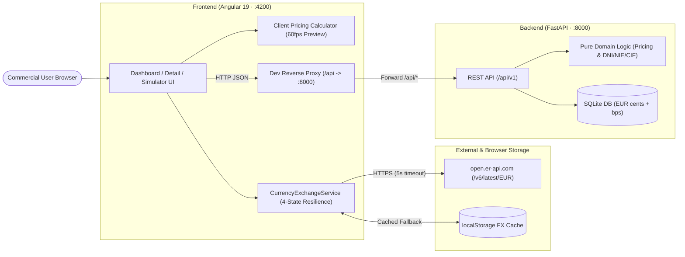
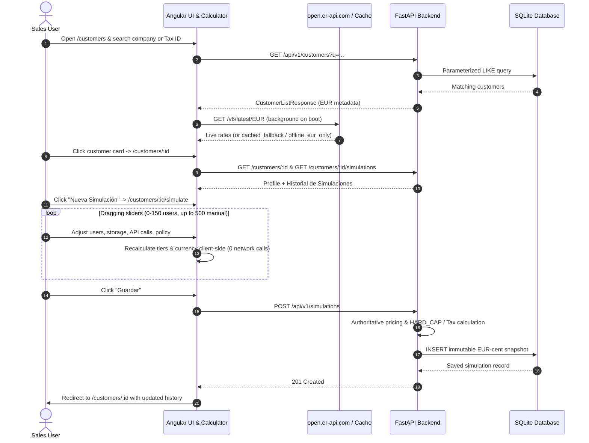
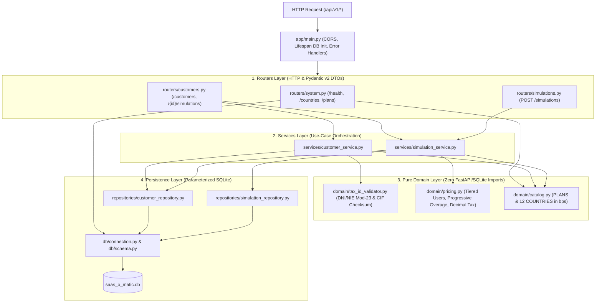
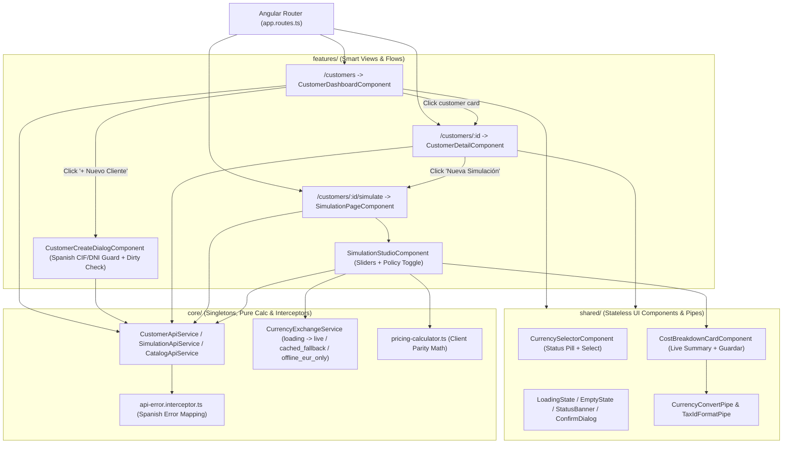

# SaaS-O-Matic

Dynamic multi-currency SaaS billing & subscription optimizer for corporate sales teams.

---

## System Architecture Overview

### How Everything Works Together

SaaS-O-Matic runs as a decoupled full-stack application:
* **Angular 19 Frontend (`http://localhost:4200`)** delivers instant 60fps pricing previews in the browser and fetches live FX rates from `open.er-api.com` (with `localStorage` fallback).
* **Angular Dev Proxy (`proxy.conf.json`)** forwards `/api/*` requests seamlessly to the FastAPI server (`http://localhost:8000`).
* **FastAPI Backend (`http://localhost:8000`)** validates requests, enforces Spanish DNI/NIE/CIF algorithms, runs authoritative EUR-cent pricing math, and persists immutable snapshots in **SQLite**.



#### End-to-End Request & Simulation Flow



---

## How the Backend Works (`backend/`)

The Python backend follows strict **Single Responsibility** layering (`routers` -> `services` -> `domain` / `repositories`):



* **Zero Float Drift:** All EUR monetary math runs in integer cents (`*_cents`) and VAT rates in basis points (`tax_rate_bps`) using `decimal.Decimal` (`ROUND_HALF_UP`).
* **Domain Exceptions -> Standardized HTTP Codes:** `NotFoundError` (`404`), `ConflictError` (`409` on duplicate `(country_code, tax_id)`), and `BusinessValidationError` (`422` on invalid DNI/NIE/CIF or `HARD_CAP` violation).

---

## How the Frontend Works (`frontend/`)

The Angular 19 frontend uses standalone components, Angular Signals, `OnPush` change detection, and unidirectional dependencies (`features/` -> `core/` & `shared/`):



---

## Backend (FastAPI + SQLite)

### Prerequisites
* **Python 3.11+** (recommended **3.12**) with `pip`
* SQLite is bundled with Python's standard library (no separate database server required)

### 1. Create and Activate the Virtual Environment (`venv`)
```powershell
cd backend
python -m venv .venv
```

Activate the virtual environment:
* **Windows (PowerShell):**
  ```powershell
  .\.venv\Scripts\Activate.ps1
  ```
* **Linux / macOS:**
  ```bash
  source .venv/bin/activate
  ```

### 2. Install Dependencies
* **Runtime + dev/test dependencies:**
  ```powershell
  pip install -r requirements-dev.txt
  ```
* *(Or runtime only: `pip install -r requirements.txt`)*

### 3. Configuration (Optional)
The backend works out of the box with default settings and initializes `backend/data/saas_o_matic.db` automatically on startup. To customize paths or CORS origins, copy `.env.example` to `.env`:
```powershell
Copy-Item .env.example .env
```

### 4. Run the API Server Locally
From `backend/` (with `.venv` activated):
```powershell
uvicorn app.main:app --reload --host 0.0.0.0 --port 8000
```
* Interactive OpenAPI / Swagger UI: `http://localhost:8000/docs`
* Health check: `http://localhost:8000/api/v1/health`

### 5. Run Tests & Linter
From `backend/` (with `.venv` activated):
```powershell
pytest -v
ruff check .
```

---

## Frontend (Angular 19 + Angular Material)

### Prerequisites
* **Node.js 20+ / 22+ (LTS)** and **npm 10+** (tested with Node 22/26)
* Google Chrome (for running headless unit tests with Karma)

### 1. Install Dependencies
```powershell
cd frontend
npm install
```

### 2. Development Server with API Proxy
Start the Angular dev server with the configured reverse proxy (`proxy.conf.json`) forwarding `/api` calls directly to `http://localhost:8000`:
```powershell
npm start
```
* Web Application UI: `http://localhost:4200`
* Hot-reload is enabled by default for all TypeScript, HTML, and SCSS edits.

### 3. Run Frontend Unit Tests
Execute the unit test suite (Karma + Jasmine) in headless mode:
```powershell
npm test -- --watch=false --browsers=ChromeHeadless
```
*(On Windows environments where Chrome is installed at custom paths, set `$env:CHROME_BIN = "C:\Program Files\Google\Chrome\Application\chrome.exe"` before executing).*

### 4. Build for Production
Generate optimized, minified production assets under `frontend/dist/frontend/`:
```powershell
npm run build
```

---

## End-to-End Local Execution Guide

To run the complete SaaS-O-Matic solution on your machine:

1. **Start the Backend API:**
   Open a terminal in `backend/` with the virtual environment activated:
   ```powershell
   cd backend
   .\.venv\Scripts\Activate.ps1
   uvicorn app.main:app --reload --host 0.0.0.0 --port 8000
   ```
   *Verify healthy status:* Open `http://localhost:8000/api/v1/health` in your browser.

2. **Start the Frontend UI:**
   Open a second terminal in `frontend/`:
   ```powershell
   cd frontend
   npm start
   ```
   *Access the app:* Open `http://localhost:4200` in your browser.

3. **Explore Key Features:**
   * **Dashboard & Search:** Search customers by company name or Tax ID (DNI/NIE/CIF) with debounced auto-query.
   * **Customer Registration:** Click **"Nuevo Cliente"** to open the registration dialog. Select Spain (ES) or International, test live Spanish CIF/DNI/NIE checksum verification, and test the dirty-form guard if canceling with entered data.
   * **Customer Detail & History (`/customers/:id`):** Click any customer card to view corporate metadata, base plan quotas, and **Historial de Simulaciones**.
   * **Simulation Studio & 60fps Slider Preview (`/customers/:id/simulate`):** Click **"Nueva Simulación"** to open the interactive simulator:
     * *Active Users:* Slider from 0 to 150 with a linked numeric input allowing up to 500 users.
     * *Storage & API Calls:* Real-time quota badges and progressive tier calculation.
     * *Overage Policy:* Toggle between `PROGRESSIVE` overage calculation and `HARD_CAP` quota guardrails.
   * **Multi-Currency:** Switch between EUR, USD, GBP, CHF, MXN, and COP with live rates from `open.er-api.com` (supported by 4 resilient states: live, cached fallback, loading, and offline EUR-only).
   * **Persistence:** Click **"Guardar"** to record an immutable simulation snapshot into SQLite and return automatically to `/customers/:id` with the updated history table.

