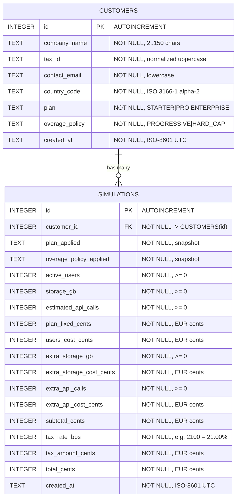

# Data Model & SQLite Schema — SaaS-O-Matic

> **Database Engine:** SQLite 3 (`PRAGMA foreign_keys = ON;`, recommended `PRAGMA journal_mode = WAL;`)  
> **Canonical Currency:** `EUR` only — all monetary amounts are persisted as **integer euro cents** (`*_cents`) to prevent IEEE-754 floating-point rounding drift.

---

## 1. Entity-Relationship Diagram



> **Note on Reference Catalogs (`countries`, `plans`):** Country VAT rates and Plan fixed rates/thresholds are static versioned domain configuration in Python (`src/domain/catalog.py`) exposed via `GET /countries` and `GET /plans`. Because every `simulations` row stores an immutable snapshot of `plan_applied`, `overage_policy_applied`, `plan_fixed_cents`, `tax_rate_bps`, and all calculated cost components, historical quotes remain accurate even if future plan pricing or country tax rates change.

---

## 2. SQLite DDL Specification

```sql
PRAGMA foreign_keys = ON;

CREATE TABLE IF NOT EXISTS customers (
    id              INTEGER PRIMARY KEY AUTOINCREMENT,
    company_name    TEXT    NOT NULL CHECK (length(trim(company_name)) BETWEEN 2 AND 150),
    tax_id          TEXT    NOT NULL CHECK (length(tax_id) BETWEEN 5 AND 20),
    contact_email   TEXT    NOT NULL CHECK (length(contact_email) <= 254),
    country_code    TEXT    NOT NULL CHECK (length(country_code) = 2 AND country_code = upper(country_code)),
    plan            TEXT    NOT NULL CHECK (plan IN ('STARTER', 'PRO', 'ENTERPRISE')),
    overage_policy  TEXT    NOT NULL DEFAULT 'PROGRESSIVE'
                            CHECK (overage_policy IN ('PROGRESSIVE', 'HARD_CAP')),
    created_at      TEXT    NOT NULL DEFAULT (strftime('%Y-%m-%dT%H:%M:%SZ', 'now')),

    CONSTRAINT uq_customers_country_tax_id UNIQUE (country_code, tax_id)
);

CREATE TABLE IF NOT EXISTS simulations (
    id                        INTEGER PRIMARY KEY AUTOINCREMENT,
    customer_id               INTEGER NOT NULL,
    plan_applied              TEXT    NOT NULL CHECK (plan_applied IN ('STARTER', 'PRO', 'ENTERPRISE')),
    overage_policy_applied    TEXT    NOT NULL CHECK (overage_policy_applied IN ('PROGRESSIVE', 'HARD_CAP')),

    -- Simulation inputs
    active_users              INTEGER NOT NULL CHECK (active_users >= 0),
    storage_gb                INTEGER NOT NULL CHECK (storage_gb >= 0),
    estimated_api_calls       INTEGER NOT NULL CHECK (estimated_api_calls >= 0),

    -- Canonical EUR snapshot (integer cents: 100 cents = 1.00 EUR)
    plan_fixed_cents          INTEGER NOT NULL CHECK (plan_fixed_cents >= 0),
    users_cost_cents          INTEGER NOT NULL CHECK (users_cost_cents >= 0),
    extra_storage_gb          INTEGER NOT NULL CHECK (extra_storage_gb >= 0),
    extra_storage_cost_cents  INTEGER NOT NULL CHECK (extra_storage_cost_cents >= 0),
    extra_api_calls           INTEGER NOT NULL CHECK (extra_api_calls >= 0),
    extra_api_cost_cents      INTEGER NOT NULL CHECK (extra_api_cost_cents >= 0),
    subtotal_cents            INTEGER NOT NULL CHECK (subtotal_cents >= 0),

    -- Tax snapshot (basis points: 2100 = 21.00%)
    tax_rate_bps              INTEGER NOT NULL CHECK (tax_rate_bps >= 0 AND tax_rate_bps <= 10000),
    tax_amount_cents          INTEGER NOT NULL CHECK (tax_amount_cents >= 0),
    total_cents               INTEGER NOT NULL CHECK (total_cents >= 0),

    created_at                TEXT    NOT NULL DEFAULT (strftime('%Y-%m-%dT%H:%M:%SZ', 'now')),

    CONSTRAINT fk_simulations_customer
        FOREIGN KEY (customer_id) REFERENCES customers(id) ON DELETE CASCADE
);

-- Lookup & search indexes
CREATE INDEX IF NOT EXISTS idx_customers_company_name
    ON customers (company_name COLLATE NOCASE);

CREATE INDEX IF NOT EXISTS idx_customers_tax_id
    ON customers (tax_id);

CREATE INDEX IF NOT EXISTS idx_customers_created_at
    ON customers (created_at DESC);

CREATE INDEX IF NOT EXISTS idx_simulations_customer_history
    ON simulations (customer_id, created_at DESC, id DESC);
```

---

## 3. Data Mapping & Integrity Rules

1. **Monetary Precision (`*_cents` $\leftrightarrow$ API `EUR`):**
   * Database stores `INTEGER` cents (e.g., `2900` $\rightarrow$ `29.00`, `14000` $\rightarrow$ `140.00`, `25531` $\rightarrow$ `255.31`).
   * API serialization converts `cents / 100` using `Decimal` quantized to 2 decimal places (`float` JSON representation in OpenAPI `double`, formatted to `0.00` in Angular).
   * Multi-currency conversion (`USD`, `GBP`, etc.) is **never stored** in SQLite; it is computed strictly at presentation time in the Angular UI.

2. **Tax Rate Precision (`tax_rate_bps`):**
   * Stored in integer basis points (`100 bps = 1.00%`), e.g., Spain (`21.00%`) = `2100`, Germany (`19.00%`) = `1900`, USA (`0.00%`) = `0`.
   * Tax calculation: `ROUND_HALF_UP((subtotal_cents * tax_rate_bps) / 10000, 0)`.

3. **Normalization Before Persistence:**
   * `customers.tax_id`: Uppercased with spaces, dots, and hyphens stripped before `INSERT` and before `GET /customers?q=` matching.
   * `customers.contact_email`: Trimmed and lowercased.
   * `customers.country_code`: Uppercased ISO 3166-1 alpha-2 code.

4. **Query Patterns Supported:**
   * **Dashboard search (`GET /customers?q=...`):** Uses `LIKE '%' || :q || '%'` against `company_name` (`COLLATE NOCASE`) and normalized `tax_id`, ordered by `created_at DESC`.
   * **Simulation history (`GET /customers/{id}/simulations`):** Covered directly by composite index `idx_simulations_customer_history (customer_id, created_at DESC, id DESC)`.

